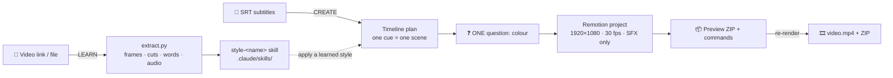

<div align="center">

# 🎬 Zobvia

### Learn any video's editing style. Create Remotion motion-graphics from an SRT.

[](LICENSE)
[](https://www.remotion.dev/)
[](https://www.python.org/)
[](#-bengali-first-class)
[](#-verification)

**One Claude skill. Two superpowers.**

`LEARN` — paste a video link, get a reusable **style skill** (pacing, cuts, captions, zooms, SFX — measured in numbers, not adjectives).
`CREATE` — paste an SRT, get a polished **1920×1080 / 30 fps motion-graphics video project**. The skill asks you exactly **one question — which colour?** — and decides everything else like a professional editor.

[Quick start](#-quick-start) · [LEARN mode](#-learn-mode) · [CREATE mode](#-create-mode) · [Capability index](#-capability-index-183-named-items) · [Examples](examples/)

</div>

---

## 🧭 How it works



## 🚀 Quick start

```bash
git clone https://github.com/<you>/zobvia.git
cd zobvia
bash install.sh                 # checks tools, installs Python deps, guides you
cp -r . ~/.claude/skills/zobvia   # or drop into a project's .claude/skills/
```

**Learn a style:**
> Watch https://youtube.com/watch?v=… and save it as `style-neon-edits`

**Create a video:**
> Make a motion graphics video from this SRT *(paste the SRT)*

**Use a learned style:**
> Edit my raw video in style-neon-edits

**Re-render / ZIP only:**
> রিভিউ করে দাও — render with SFX · Can it be sent as ZIP?

## 🎓 LEARN mode

| Step | What happens |
|---|---|
| A0 | `scripts/check_tools.py` verifies ffmpeg / yt-dlp / Whisper — fixes before asking you |
| A1 | `scripts/extract.py` downloads, samples frames, detects cuts, transcribes word timings, profiles audio |
| A2–A5 | Frame-pair, caption, SFX/music, hook & ending analysis — saved to disk after every batch |
| A6 | Synthesis in **measurable numbers** ("avg shot 1.8 s, punch-in 110% every 3rd cut…") |
| A7–A8 | Saved as `.claude/skills/style-<slug>/` + a 5-bullet recap with an example prompt |

⚖️ **Style only, never the source:** LEARN never reuses a creator's footage, voice, music, or exact graphics.

## 🎨 CREATE mode

- **Golden rule:** you are the DIRECTOR, the skill is the EDITOR. One question (colour, 6 options with hex + meaning, in your SRT's language). No second question. Ever.
- **Timeline:** every SRT cue becomes a scene — timing comes from the SRT, content is never invented.
- **16 style pipelines** (Glossy UI, Dark Tech, Bento Grid, Kinetic Typography, Data Dashboard…) with a proven 60–90 s recipe arc, max 2–3 styles per minute.
- **SFX only, no music:** 7 procedurally-generatable sound types (`scripts/sfx_gen.py`), 5–7 events per video, never masking the voice.
- **Delivery:** Preview = project ZIP + `npm install` / `npx remotion studio` / `npx remotion render Main out/video.mp4`. Re-render = MP4 + ZIP.

## 🇧🇩 Bengali, first class

Most tools break Bengali. zobvia doesn't:

- Animates **syllables (graphemes)**, never letters — conjuncts like ক্ষ, জ্ঞ, ষ্ণ stay intact
- `letterSpacing: 0`, line breaks only at word boundaries, Hind Siliguri by default
- Latin tool names (*ChatGPT, Midjourney*) sized +4–6% inside Bengali lines
- Full rules in [`references/bengali-text-rules.md`](references/bengali-text-rules.md), RTL + Devanagari in [`references/multilingual-typography.md`](references/multilingual-typography.md)

## 📚 Capability index (183 named items)

| Library | Count | File |
|---|---:|---|
| Style pipelines | 16 | `references/style-pipelines.md` |
| Text + card animations & core transitions | 20 | `references/animation-library.md` |
| SFX types (with code recipes) | 7 | `references/sfx-library.md` |
| Caption presets | 14 | `references/captions-library.md` |
| Extended transitions | 18 | `references/transitions-library.md` |
| Camera moves | 14 | `references/camera-moves.md` |
| Hook patterns (first 3 seconds) | 18 | `references/hooks-library.md` |
| CTA / outro patterns | 12 | `references/cta-outro-library.md` |
| Title formulas | 12 | `references/thumbnail-title.md` |
| Genre recipes | 20 | `references/genre-recipes.md` |
| Ready-to-say prompts | 32 | `references/prompt-library.md` |
| Colour tones (× 6 swatches, WCAG-checked) | 11 | `references/color-system.md` |
| Platform specs (YT, Shorts, Reels, TikTok, FB, LinkedIn) | 7 | `references/platform-specs.md` |

Plus: 27 reference files total, 7 working scripts, a compilable Remotion starter
([`templates/remotion-starter/`](templates/remotion-starter/)), voiceover workflow,
licensing-safe music/SFX sourcing, export matrix, project workflow, QC checklist,
client brief template, and freelancer pricing guidance (Bangladesh + international).

## ✅ Verification

This repo ships with a test suite — not claims:

```bash
python3 -m unittest discover -s tests     # 12 tests: SRT, palettes, SFX WAVs
python3 scripts/check_tools.py            # honest tool report for your machine
```

Verified end-to-end: SRT parsing (incl. Bengali + malformed blocks), palette
contrast maths, WAV generation (headers/durations), `extract.py` on a real clip
(scene-cut detection; transcription honestly *skipped with a recorded reason*
when Whisper isn't installed — never faked), and `tsc --noEmit` on the Remotion
starter. A still-frame render requires direct access to Google Fonts from the
rendering machine; see `CHANGELOG.md` for the exact verification log.

## 📁 Structure

```
zobvia/
├── SKILL.md                  # the skill: routing, LEARN A0–A8, CREATE B0–B12, hard rules
├── references/               # 26 files — pipelines, captions, hooks, genres, platforms…
├── scripts/                  # extract · srt_parse · color_palette · sfx_gen · check_tools · style_stats
├── templates/remotion-starter/  # working Remotion 4 project (Main + PreviewAudio)
├── examples/                 # example SRT → generated timeline + filled Dark Tech style skill
└── tests/                    # unittest suite for the scripts
```

## 📄 License

MIT — see [LICENSE](LICENSE). Use it, ship videos with it, sell your editing services with it.
