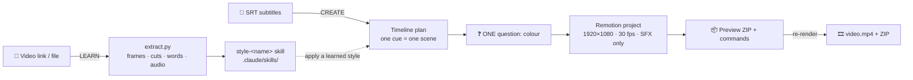

<div align="center">

# 🎬 Zobvia

### Learn any video's editing style. Create Remotion motion-graphics from an SRT.

[](LICENSE)
[](https://www.remotion.dev/)
[](https://www.python.org/)
[](#-bengali-first-class)
[](#-verification)
[](https://github.com/zobaerio/zobvia/actions/workflows/tests.yml)

**One Claude skill. Two superpowers.**

`LEARN` — paste a video link, get a reusable **style skill** (pacing, cuts, captions, zooms, SFX — measured in numbers, not adjectives).
`CREATE` — paste an SRT, get a polished **1920×1080 / 30 fps motion-graphics video project**. The skill asks you exactly **one question — which colour?** — and decides everything else like a professional editor.

[Quick start](#-quick-start) · [Full video guide](#-how-to-make-a-video--the-complete-guide) · [LEARN mode](#-learn-mode) · [CREATE mode](#-create-mode) · [Capability index](#-capability-index-183-named-items) · [Examples](examples/)


</div>

---

## 🧭 How it works



## 🚀 Quick start

```bash
git clone https://github.com/zobaerio/zobvia.git
cd zobvia
bash install.sh                 # asks the access password, checks tools, installs Python deps
cp -r . ~/.claude/skills/zobvia   # or drop into a project's .claude/skills/
```

> 🔐 **Access password:** the installer asks for a password once per machine.
> The password is the author's GitHub username: **`zobaerio`**
> Only a SHA-256 hash of it is stored in the code — the password itself is
> never saved. After a successful install you won't be asked again on that
> machine (marker: `~/.zobvia/access-ok`). Installing via the ZIP instead?
> Claude will ask for the same password the first time the skill runs.

**Learn a style:**
> Watch https://youtube.com/watch?v=… and save it as `style-neon-edits`

**Create a video:**
> Make a motion graphics video from this SRT *(paste the SRT)*

**Use a learned style:**
> Edit my raw video in style-neon-edits

**Re-render / ZIP only:**
> রিভিউ করে দাও — render with SFX · Can it be sent as ZIP?

## 🎓 LEARN mode

| Step | What happens |
|---|---|
| A0 | `scripts/check_tools.py` verifies ffmpeg / yt-dlp / Whisper — fixes before asking you |
| A1 | `scripts/extract.py` downloads, samples frames, detects cuts, transcribes word timings, profiles audio |
| A2–A5 | Frame-pair, caption, SFX/music, hook & ending analysis — saved to disk after every batch |
| A6 | Synthesis in **measurable numbers** ("avg shot 1.8 s, punch-in 110% every 3rd cut…") |
| A7–A8 | Saved as `.claude/skills/style-<slug>/` + a 5-bullet recap with an example prompt |

⚖️ **Style only, never the source:** LEARN never reuses a creator's footage, voice, music, or exact graphics.

## 🎨 CREATE mode

- **Golden rule:** you are the DIRECTOR, the skill is the EDITOR. One question (colour, 6 options with hex + meaning, in your SRT's language). No second question. Ever.
- **Timeline:** every SRT cue becomes a scene — timing comes from the SRT, content is never invented.
- **16 style pipelines** (Glossy UI, Dark Tech, Bento Grid, Kinetic Typography, Data Dashboard…) with a proven 60–90 s recipe arc, max 2–3 styles per minute — **all 16 implemented as data-driven components** in the starter, plus coded transitions (cut / whip / slide / zoom / fade) and 6 caption presets.
- **SFX only, no music:** 7 procedurally-generatable sound types (`scripts/sfx_gen.py`), 5–7 events per video, never masking the voice.
- **Delivery:** Preview = project ZIP + `npm install` / `npx remotion studio` / `npx remotion render Main out/video.mp4`. Re-render = MP4 + ZIP.

## ⚡ One-command converter

Already have an SRT and a colour? Skip the ceremony — one command
builds the complete, ready-to-preview project:

```bash
python3 scripts/create_video.py --srt video.srt --palette tech --out my-video
# options: --palette "#0EA5E9"  ·  --aspect 9:16  ·  --title "My Video"
# pro:     --captions karaoke-highlight  ·  --aspects 16:9,9:16,1:1
#          --voiceover voice.mp3  ·  --render
```

What you get in `my-video/`:

- `src/data/timeline.json` — one scene per cue, planned automatically:
  Kinetic Hook first, Statement → Recap → CTA at the end of longer
  SRTs, and middle scenes that rotate **within one layout family**
  chosen from the SRT's dominant signal (step words → flow family:
  Timeline / Hub-and-Spoke; numbers → grid family: Dashboard / Bento;
  otherwise the stage family: Glossy UI, 3D Carousel, Glass Cards,
  Minimal Clean, Gradient Fluid). Every scene also carries a
  `transition` — about 80% hard cuts, a whip only on a topic change
  (≥ 1.5 s pause or a section keyword, max 3 per video), slide / zoom /
  fade sparingly — and the project carries a `captions` preset
- `src/theme.ts` — your palette, resolved and WCAG-checked
- `timeline.md` — the human-readable plan (scene table + SFX map)
- `public/sfx/*.wav` + `src/data/sfx.json` — 5–7 generated SFX events,
  wired into the composition (SFX only, no music)
- `PROJECT_README.md` — what was generated + the 3 run commands

**Pro flags:** `--captions <id>` picks one of 6 implemented caption
presets (`word-by-word` default, `karaoke-highlight`, `bilingual-stack`
— the cue's own Bengali and Latin words stacked, never a fabricated
translation — `classic-bottom`, `boxed-bold`, `minimal-line`).
`--aspects 16:9,9:16,1:1` builds one project per aspect into
`my-video/16x9`, `my-video/9x16`, `my-video/1x1`. `--voiceover
<file.mp3|wav>` copies your recording into the project, probes it with
ffprobe, and warns if it drifts from the SRT by more than a second.
`--render` goes all the way — install, render, QC-check — and fails
loudly, naming the step, if anything goes wrong.

The starter's `Main` composition is data-driven, so the generated
project just works: `npm install`, `npx remotion studio`, done.
A real converter output is committed at
[`examples/generated-project/`](examples/generated-project/) — browse
it to see exactly what the command produces.

Two companion tools round out the converter:

```bash
python3 scripts/transcribe.py --in voice.mp3 --out voice.srt   # media → SRT (Whisper)
python3 scripts/qc_check.py --file out/video.mp4 --expect-width 1920 --expect-height 1080 --expect-fps 30
```

`transcribe.py` uses faster-whisper or the `whisper` CLI; with neither
installed it says so and exits 3 — it never invents a transcript.
`qc_check.py` probes a render with ffprobe and PASS/FAILs each
expectation you give it.

## 🎬 How to make a video — the complete guide

Everything below is the whole workflow, start to finish. No editing
experience needed: you supply words, Zobvia does the editing.

### Step 0 — Install (once)

1. Clone or download this repo (see Quick start above).
2. Run `bash install.sh`. It asks for the **access password** — type
   `zobaerio` — then checks your tools (Python, ffmpeg, Node) and tells
   you exactly what to install if anything is missing.
3. Copy the folder into your Claude skills directory
   (`~/.claude/skills/zobvia`), or drop the ZIP into Claude's skill section.
4. Open Claude and say: **"Make a motion graphics video from this SRT"** —
   if this machine hasn't been unlocked yet, Claude asks for the access
   password first (same one: `zobaerio`), verifies it, and never asks again.

### Step 1 — Get an SRT file

An SRT is a subtitle file: numbered blocks with timestamps and one or two
lines of text each. Ways to get one:

- **From a script you wrote:** paste your script to Claude and say
  "turn this into an SRT" — or write it by hand following
  [`examples/example-bengali.srt`](examples/example-bengali.srt).
- **From a YouTube video:** download the captions (many free tools export
  `.srt`), or let LEARN mode's transcription produce one.
- **From a voiceover:** record your voice, and ask Claude to transcribe it
  into a timed SRT (see `references/voiceover-workflow.md`).

One SRT cue = one scene on screen, so keep cues to one idea each
(roughly 1–2 lines, 2–5 seconds).

### Step 2 — Paste the SRT and the prompt

Paste your SRT into Claude with one line, or use the flagship
[Master CREATE Prompt](references/master-create-prompt.md) verbatim:

> Make a motion graphics video from this SRT: *(paste SRT)*

That is all you have to write. Zobvia reads the whole SRT, understands the
subject and tone, and plans the full timeline itself
(`timeline.md` is generated before any code, so you can see the plan).

### Step 3 — Answer ONE question: colour

Zobvia asks exactly one question — **"কোন রঙ চান?" / "Which colour?"** —
with 6 palettes (name, hex codes, and what mood each gives). Pick a number
or a name. No other questions will be asked; pacing, styles, captions,
zooms and SFX are decided by the skill like a professional editor.

### Step 4 — Preview (default delivery)

You receive a **project ZIP** plus three commands:

```bash
npm install
npx remotion studio
npx remotion render Main out/video.mp4
```

- `npm install` — one-time setup inside the unzipped project.
- `npx remotion studio` — opens the video in your browser so you can
  watch it, scrub through scenes, and check the Bengali text.
- If you added a `voiceover.mp3` into the project's `public/` folder, the
  **PreviewAudio** composition plays it; without it, the video is silent
  except the built-in SFX.

### Step 5 — Ask for changes (optional)

Every delivery ends with **"কিছু সিন বদলাতে চান?"** ("Want any scene
changed?"). Just say what to change in plain words:

- "Make scene 3 slower" · "Change the caption style to Karaoke Highlight"
- "Use my `style-neon-edits` for the whole video" · "Make a 9:16 version too"

### Step 6 — Render the final video

Say **"render"** and you get back:

- 🎞️ `video.mp4` — 1920×1080, 30 fps, word-by-word animated captions,
  5–7 soft SFX events, no music (unless you asked for a vertical version:
  say "render 9:16" for Shorts/Reels/TikTok, 1080×1920).
- 📦 the updated project ZIP + the same 3 commands.

Say **"ZIP"** instead if you only want the project files without rendering.

### Making a video in a learned style (LEARN → CREATE)

1. **Learn:** "Watch *<video link>* and save it as `style-my-style`" —
   Zobvia measures the video's pacing, cuts, captions, colours and SFX
   and saves a reusable style skill (style only — never the creator's
   footage, voice or music).
2. **Create:** "Make a video from this SRT using `style-my-style`" —
   your new video is edited in that measured style.

### 🇧🇩 বাংলায় ঝটপট গাইড

1. **ইনস্টল:** repo ডাউনলোড করে `bash install.sh` চালান — পাসওয়ার্ড চাইলে লিখুন `zobaerio`।
2. **SRT দিন:** Claude-কে বলুন "এই SRT থেকে মোশন গ্রাফিক্স ভিডিও বানাও" আর SRT-টা paste করুন।
3. **একটা প্রশ্নের উত্তর দিন:** "কোন রঙ চান?" — ৬টা রঙের মধ্যে একটা বেছে নিন। ব্যাস, আর কোনো প্রশ্ন নেই।
4. **প্রিভিউ দেখুন:** ZIP আর ৩টা command পাবেন — `npx remotion studio` দিয়ে ব্রাউজারে ভিডিওটা দেখুন।
5. **বদল চাইলে বলুন:** কোন সিন বদলাতে চান শুধু বললেই হবে।
6. **ফাইনাল ভিডিও:** "render" বললেই `video.mp4` + ZIP হাতে পাবেন।

### FAQ

- **Do I need to know video editing?** No. You write the words (SRT) and
  pick a colour. Everything else is the skill's job.
- **Can it add music?** No — CREATE is SFX-only by design (5–7 soft UI
  sounds per video), so the voice is never masked. Add your own music
  afterwards if you want it.
- **Bengali text breaks in other tools. Here?** Zobvia animates whole
  syllables (graphemes), never splits conjuncts (ক্ষ, জ্ঞ, ষ্ণ),
  uses `letterSpacing: 0` and Hind Siliguri — see the Bengali section below.
- **Wrong password / new machine?** The password is always the author's
  GitHub username, `zobaerio`. Each machine asks once.
- **What if a tool is missing?** Run `python3 scripts/check_tools.py` —
  it gives an honest report and the exact install command for your OS.

## 🇧🇩 Bengali, first class

Most tools break Bengali. zobvia doesn't:

- Animates **syllables (graphemes)**, never letters — conjuncts like ক্ষ, জ্ঞ, ষ্ণ stay intact
- `letterSpacing: 0`, line breaks only at word boundaries, Hind Siliguri by default
- Latin tool names (*ChatGPT, Midjourney*) sized +4–6% inside Bengali lines
- Full rules in [`references/bengali-text-rules.md`](references/bengali-text-rules.md), RTL + Devanagari in [`references/multilingual-typography.md`](references/multilingual-typography.md)

## 📚 Capability index (183 named items)

| Library | Count | File |
|---|---:|---|
| Style pipelines | 16 | `references/style-pipelines.md` |
| Text + card animations & core transitions | 20 | `references/animation-library.md` |
| SFX types (with code recipes) | 7 | `references/sfx-library.md` |
| Caption presets | 14 | `references/captions-library.md` |
| Extended transitions | 18 | `references/transitions-library.md` |
| Camera moves | 14 | `references/camera-moves.md` |
| Hook patterns (first 3 seconds) | 18 | `references/hooks-library.md` |
| CTA / outro patterns | 12 | `references/cta-outro-library.md` |
| Title formulas | 12 | `references/thumbnail-title.md` |
| Genre recipes | 20 | `references/genre-recipes.md` |
| Ready-to-say prompts | 32 | `references/prompt-library.md` |
| Colour tones (× 6 swatches, WCAG-checked) | 11 | `references/color-system.md` |
| Platform specs (YT, Shorts, Reels, TikTok, FB, LinkedIn) | 7 | `references/platform-specs.md` |

Plus: 27 reference files total, 11 working scripts, a compilable Remotion starter
([`templates/remotion-starter/`](templates/remotion-starter/)), voiceover workflow,
licensing-safe music/SFX sourcing, export matrix, project workflow, QC checklist,
client brief template, and freelancer pricing guidance (Bangladesh + international).

## ✅ Verification

This repo ships with a test suite — not claims:

```bash
python3 -m unittest discover -s tests     # 27 tests: SRT, palettes, SFX WAVs, access gate, converter, transcribe, QC, planner/captions/aspects/voiceover/render
python3 scripts/check_tools.py            # honest tool report for your machine
```

CI (`.github/workflows/tests.yml`) runs the Python suite and the
starter typecheck on every push and pull request.

Verified end-to-end: SRT parsing (incl. Bengali + malformed blocks), palette
contrast maths, WAV generation (headers/durations), `extract.py` on a real clip
(scene-cut detection; transcription honestly *skipped with a recorded reason*
when Whisper isn't installed — never faked), the one-command converter on the
Bengali and English example SRTs (10 scenes, 7 SFX events, 45 s each), the
family planner on a 24-cue SRT (5 stage pipelines in rotation, 83% hard cuts,
ending trio intact), multi-aspect generation (16:9 / 9:16 / 1:1 dimensions),
voiceover drift warning on a mismatched recording, `--render` failure
reporting with stubbed tools (names the failing step, never fakes success),
`qc_check.py` against a real ffmpeg-generated clip, and `tsc --noEmit` on both
the Remotion starter (all 16 pipeline components) and a converter-generated
project. A still-frame render requires direct access to Google Fonts from
the rendering machine; see `CHANGELOG.md` for the exact verification log.

## 📁 Structure

```
zobvia/
├── SKILL.md                  # the skill: routing, LEARN A0–A8, CREATE B0–B12, hard rules
├── references/               # 27 files — pipelines, captions, hooks, genres, platforms…
├── scripts/                  # extract · srt_parse · color_palette · create_video · sfx_gen · check_tools · style_stats · access_check · transcribe · qc_check · render_helper.sh
├── assets/                   # animated demo banner (demo.svg)
├── templates/remotion-starter/  # working Remotion 4 project — data-driven Main + PreviewAudio, all 16 pipeline components, transitions, caption presets
├── examples/                 # Bengali + English example SRTs → generated timeline + filled Dark Tech style skill + generated-project/ (real converter output)
└── tests/                    # unittest suite for the scripts
```

## 📄 License

MIT — see [LICENSE](LICENSE). Use it, ship videos with it, sell your editing services with it.
